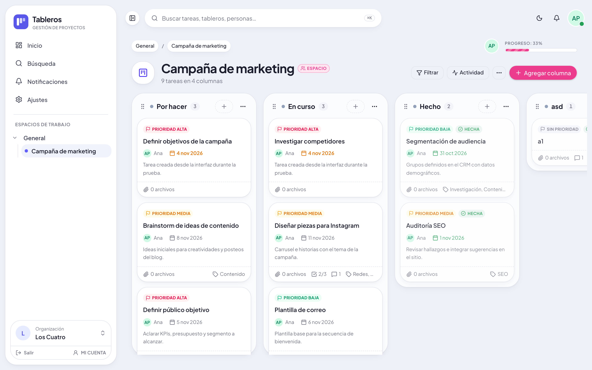
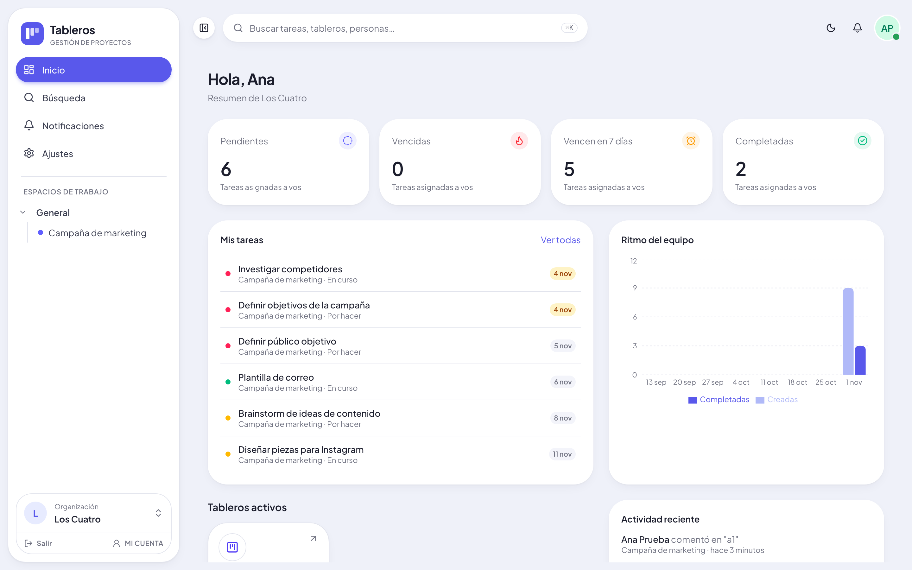
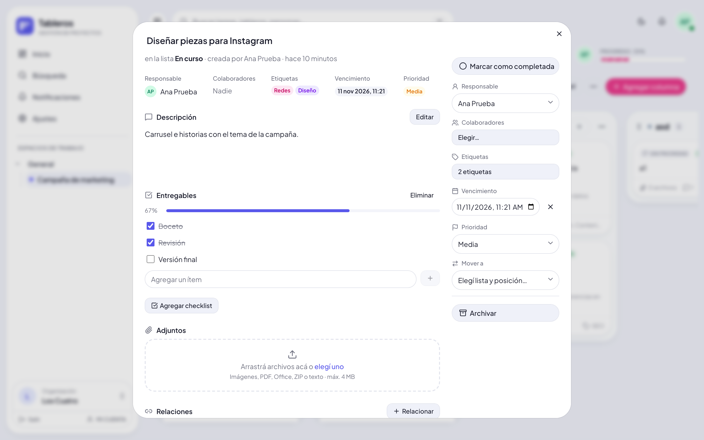
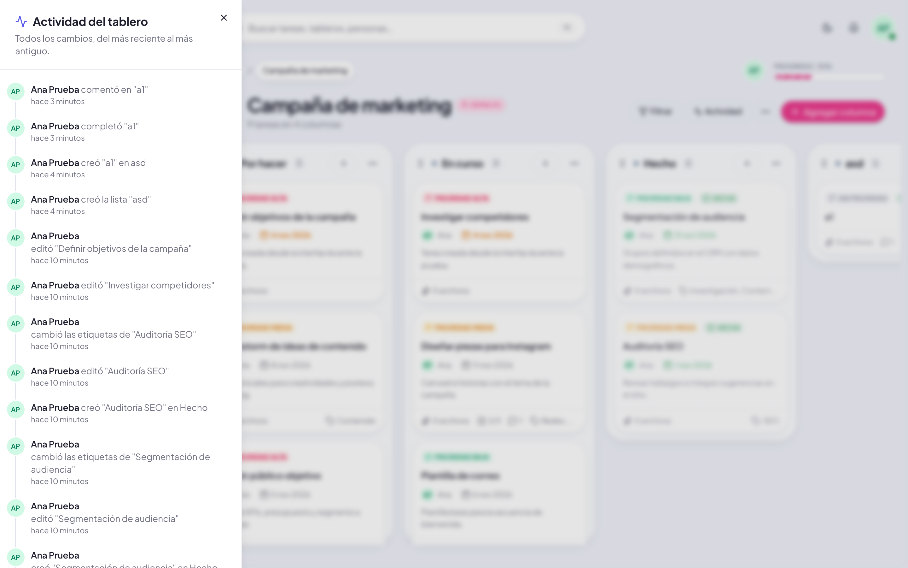
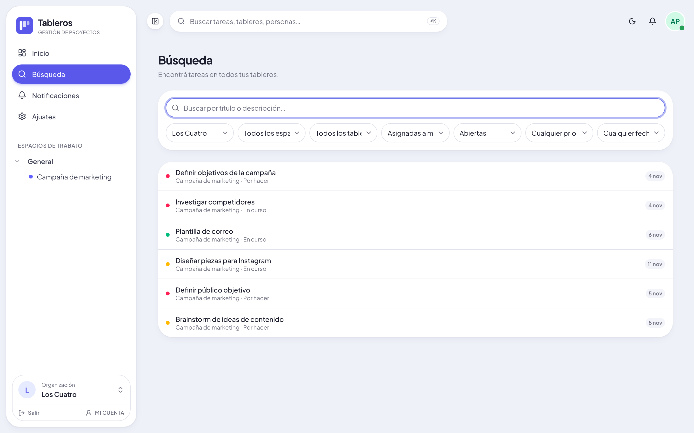
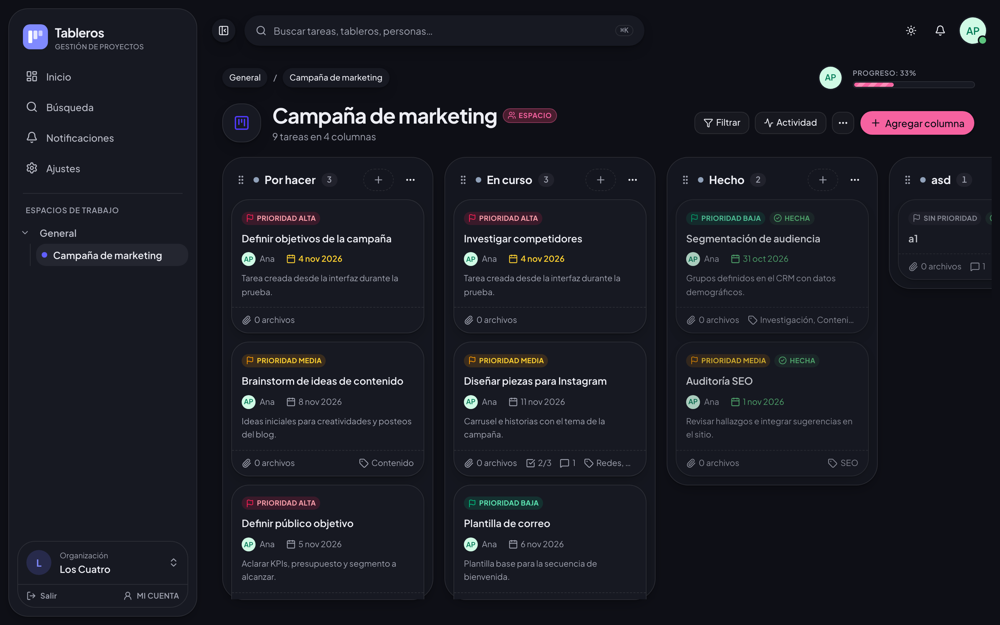
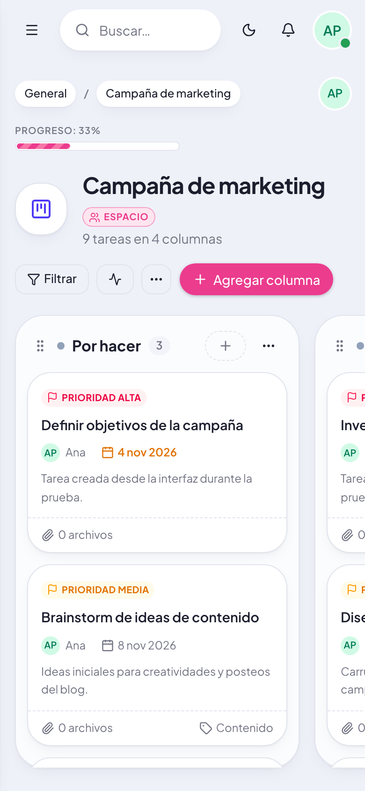
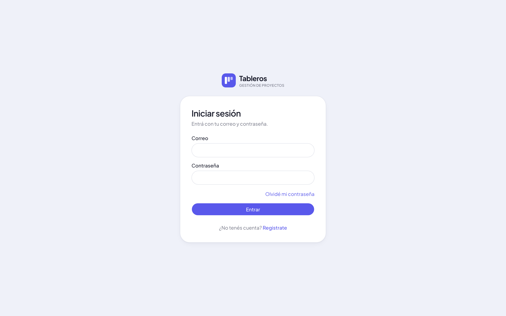

<div align="center">


# Tableros

**Gestión de proyectos y tareas con tableros Kanban, pensada para equipos chicos.**

Organizá el trabajo en columnas, asigná responsables y fechas, conversá en cada tarea y seguí el avance del equipo desde un solo lugar.


</div>



## ¿Qué es?

Tableros es una aplicación web para organizar proyectos con el método Kanban. Cada equipo tiene su **organización**, la divide en **espacios de trabajo** (por área o cliente) y dentro de cada uno arma **tableros** con columnas y tarjetas. Cada tarjeta concentra todo lo que hace falta para avanzar: responsable, fecha, prioridad, checklist, archivos y la conversación del equipo.

Está construida como un producto completo: autenticación propia, permisos por rol, aislamiento de datos entre organizaciones, auditoría, modo claro y oscuro, diseño responsive y accesibilidad por teclado. Corre de forma **gratuita** sobre Vercel + Supabase.

## Capturas

| Inicio | Detalle de tarjeta |
|---|---|
|  |  |

| Actividad del tablero | Búsqueda con filtros |
|---|---|
|  |  |

| Modo oscuro | Celular | Inicio de sesión |
|---|---|---|
|  |  |  |

## Funcionalidades

**Tableros Kanban**
- Columnas y tarjetas con arrastrar y soltar (mouse y teclado), reordenamiento de columnas y colores por lista.
- Filtros por persona, etiqueta, prioridad y vencimiento; barra de progreso del tablero.
- Archivado y restauración de listas y tarjetas.

**Tarjetas**
- Descripción con texto enriquecido, prioridad, responsable, colaboradores, etiquetas y fecha de vencimiento.
- Checklists con progreso, archivos adjuntos (imágenes, PDF, Office, texto), relaciones entre tareas (bloquea, relacionada, duplica).
- Comentarios con **@menciones** e historial completo de cambios.

**Colaboración**
- Organizaciones, espacios de trabajo y tableros con roles y **invitaciones por correo**.
- Notificaciones internas (asignaciones, menciones, comentarios, vencimientos próximos).
- Actualización casi en tiempo real: los cambios de otras personas aparecen solos y se resaltan.
- Panel de actividad por tablero y registro de auditoría por organización.

**Seguimiento**
- Inicio con tareas pendientes, vencidas, por vencer y completadas, gráfico de ritmo semanal, tableros activos y actividad reciente.
- Búsqueda global (⌘K) y búsqueda avanzada por organización, espacio, tablero, persona, estado, prioridad y fecha.

**Cuenta y seguridad**
- Registro con verificación de correo, recuperación de contraseña, verificación en dos pasos (TOTP) con códigos de recuperación.
- Gestión de sesiones abiertas, cambio de contraseña y eliminación de cuenta.

## Integración con GitHub

Cada tablero puede vincularse a un repositorio (GitLab está en camino con el mismo diseño):

- **Conexión segura** con un token *fine-grained* guardado cifrado; nunca llega al navegador.
- **Importación** de los issues abiertos como tarjetas y creación de issues desde cualquier tarjeta.
- **Sincronización bidireccional** de título, descripción (Markdown ↔ texto enriquecido), etiquetas, prioridad (como etiqueta `prioridad: …`), responsable y estado. Mover una tarjeta a la lista de terminado cierra el issue.
- **Sin ecos ni pisadas:** cada vínculo guarda la huella local y remota del último estado; si ambos lados cambiaron, la tarjeta muestra el conflicto y una persona decide.
- **Desarrollo en la tarjeta:** PRs que mencionan el issue (título, descripción o rama `12-…`), con estado, revisión y resultado de los checks.
- **Cerrar un issue no completa la tarjeta:** se puede mover a una columna de revisión; la decisión final queda en el tablero.
- **Webhooks** firmados (HMAC SHA-256) y deduplicados en producción; en local, sincronización por sondeo al abrir el tablero y cada 2 minutos.


- **Equipo de marketing** que planifica una campaña: columnas *Por hacer / En curso / Revisión / Hecho*, piezas con fecha de entrega, checklist de entregables y archivos adjuntos.
- **Grupo de amigos o estudio chico** que organiza un proyecto en común: cada uno ve sus tareas en el inicio y recibe aviso cuando lo mencionan o algo está por vencer.
- **Freelancer con clientes**: un espacio de trabajo por cliente y tableros privados; el cliente entra como **invitado** y solo ve su tablero.
- **Equipo de desarrollo** que lleva un backlog: prioridades, relaciones de bloqueo entre tareas y búsqueda por etiqueta o responsable.
- **Coordinación de un evento**: fechas de vencimiento, recordatorios automáticos y el historial de quién cambió qué.

## Roles y permisos

| Organización | Puede |
|---|---|
| **Dueño** | Todo, incluido eliminar la organización y nombrar otros dueños |
| **Administrador** | Gestionar miembros, invitaciones, espacios y ver la auditoría |
| **Miembro** | Crear espacios y tableros, trabajar en los tableros a los que accede |
| **Invitado** | Solo los tableros a los que lo agregan |

En cada tablero: **Administrador** (configura y gestiona miembros) · **Editor** (crea y mueve tarjetas) · **Comentarista** (comenta) · **Lector** (solo ve). Todos los permisos se validan en el servidor.

## Tecnologías

| Capa | Tecnología |
|---|---|
| Framework | [Next.js 16](https://nextjs.org) (App Router) + TypeScript estricto |
| Interfaz | [shadcn/ui](https://ui.shadcn.com) (Radix) · Tailwind CSS v4 · [lucide-react](https://lucide.dev) · Plus Jakarta Sans |
| Interacción | [dnd-kit](https://dndkit.com) (drag & drop accesible) · [TipTap](https://tiptap.dev) (texto enriquecido) · [Recharts](https://recharts.org) · cmdk |
| Datos en cliente | TanStack Query |
| Base de datos | PostgreSQL ([Supabase](https://supabase.com)) · [Drizzle ORM](https://orm.drizzle.team) · migraciones SQL versionadas |
| Autenticación | JWT propio con [jose](https://github.com/panva/jose) (Ed25519) · Argon2id · TOTP (otplib) |
| Validación | Zod (también genera el OpenAPI) |
| Archivos | Supabase Storage (bucket privado) |
| Correo | SMTP (Nodemailer) |
| Tests | Vitest (integración contra Postgres real) · Playwright |
| CI/CD | GitHub Actions · Gitleaks · Semgrep · OSV-Scanner · Dependabot · Vercel |

## Arquitectura

```
Navegador (React, sin claves ni secretos)
   │  cookies HttpOnly
   ▼
proxy.ts ── CSP con nonce y headers de seguridad
   ▼
Next.js — monolito modular
   ├─ app/(auth), app/(app)          pantallas
   └─ app/api/v1/[...path]            API única → src/server/api/router.ts
          CSRF · autenticación · rate limit · validación · errores seguros · OpenAPI
          └─ src/server/modules/*    auth · perfil · organizaciones · espacios · tableros · tarjetas · dashboard · cron
   ▼
PostgreSQL (esquema app + RLS)   Storage privado   SMTP   Vercel Cron
```

- **El navegador solo habla con la API propia.** La base de datos, el almacenamiento y el correo se usan exclusivamente desde el servidor.
- **Aislamiento entre organizaciones en capas:** autorización central, *Row-Level Security* de Postgres (cada request corre con un rol sin privilegios y el usuario en contexto) y claves foráneas compuestas por organización.
- **Una sola fuente de verdad para los permisos:** el rol efectivo en cada tablero lo resuelve una función SQL.
- La documentación de la API está en `/docs/api` y la especificación en `/api/v1/openapi.json`.

## Seguridad

- Contraseñas con Argon2id, bloqueo temporal tras intentos fallidos y mensajes que no revelan si una cuenta existe.
- Access token de 10 minutos y refresh token rotativo; reutilizar uno viejo revoca la sesión. Cerrar sesión o cambiar la contraseña invalida los tokens al instante.
- Protección CSRF (cookies `SameSite` + validación de `Origin`), CSP estricta, validación de toda entrada y texto enriquecido con lista blanca (sin HTML).
- Adjuntos validados por su contenido real, con tamaño máximo, nombres saneados, almacenamiento privado y descarga solo con permiso.
- Auditoría inmutable de eventos sensibles; los logs nunca guardan contraseñas, tokens ni cookies.
- Políticas de retención automáticas y CI que bloquea vulnerabilidades altas o críticas.

## Empezar en local

Requisitos: Node 22+, pnpm y Docker.

```bash
pnpm install
pnpm run setup:dev   # genera .env.local con claves nuevas, levanta Postgres y migra
pnpm dev             # http://localhost:3000
```

En desarrollo los correos (verificación, invitaciones, recuperación) se guardan en `.data/mail/` y los adjuntos en `.data/uploads/`.

```bash
pnpm test                    # tests de integración (auth, aislamiento, permisos, kanban, archivos)
pnpm lint && pnpm typecheck && pnpm build
```

Las capturas de este README se regeneran con `scripts/screenshots.mts`.
